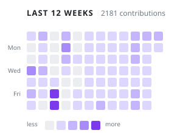
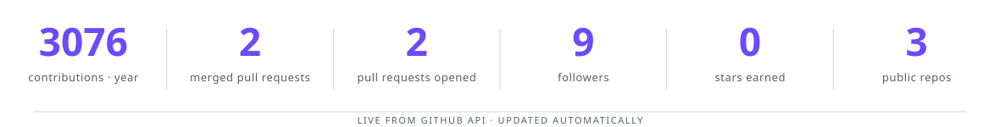
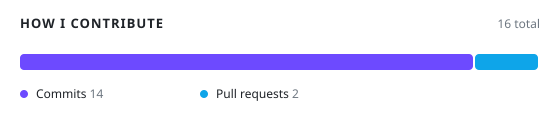
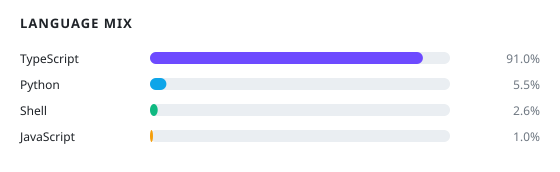
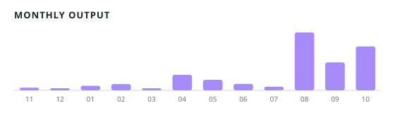
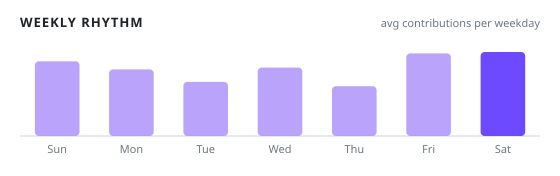

<div align="center">

<picture>
  <source media="(prefers-color-scheme: dark)" srcset="assets/hero-dark.svg" />
  
</picture>

<a href="https://github.com/hdsm55">
  
</a>

<p>
  
  
  
  
</p>

<p>
  
  
  
</p>

</div>

<div align="center">

<a href="#-about"></a>
<a href="#-what-i-build"></a>
<a href="#-tech-stack"></a>
<a href="#-live-products"></a>
<a href="#-by-the-numbers"></a>
<a href="#-principles"></a>

</div>

<p align="center">
  
  <a href="./README.ar.md"></a>
</p>


<div align="center">

<picture>
  <source media="(prefers-color-scheme: dark)" srcset="assets/divider-dark.svg" />
  
</picture>

</div>

## 👋 About

I'm a **full-stack developer** who ships production web platforms end-to-end — from the
database schema and API design to the interface users actually touch.

My work tends to sit where **product engineering meets operations**: a feature isn't done
when it compiles, it's done when it runs reliably on a real server, survives a restart,
and can be debugged at 2 AM. I like owning that whole path.

I care about three things:

- **Clean architecture** — boundaries that hold up as the product grows.
- **Self-hosted infrastructure** — I'd rather understand my stack than rent a black box.
- **Developer tooling** — small tools that remove friction beat big frameworks that add it.

```ts
const husam = {
  role: "Full-Stack Developer",
  frontend: ["TypeScript", "React", "Next.js", "Tailwind"],
  backend: ["Node.js", "Fastify", "Express", "Python", "FastAPI"],
  data: ["PostgreSQL/PostGIS", "Redis", "Drizzle", "Prisma"],
  ops: ["Linux", "Docker", "Caddy/Nginx", "Cloudflare", "CI/CD", "systemd"],
  mobile: ["Flutter", "React Native / Expo", "Capacitor"],
  philosophy: "Ship small, ship reliable, keep it observable.",
};
```


<div align="center">

<picture>
  <source media="(prefers-color-scheme: dark)" srcset="assets/divider-dark.svg" />
  
</picture>

</div>

## 🧭 What I Build

**🏗️ Production platforms**
Real applications with real data, real authentication and real traffic. Schema → API → UI,
designed so the second feature is cheaper than the first.

**⚙️ Self-hosted infrastructure**
Linux servers, containers, reverse proxies, CI/CD pipelines and DNS. From the metal to the
TLS certificate — including backups and restore drills, not just the happy path.

**🧰 Developer tooling**
Small, sharp CLIs and automations. Zero runtime dependencies when possible, documented by
default, and boring on purpose.

**🌍 Arabic-first products**
Full RTL experiences that feel native — proper typography, logical CSS properties, and
layouts that don't break when the language is Arabic.


<div align="center">

<picture>
  <source media="(prefers-color-scheme: dark)" srcset="assets/divider-dark.svg" />
  
</picture>

</div>

## 🛠️ Tech Stack

<div align="center">


</div>

| Layer | Tools |
|:--|:--|
| **Frontend** | TypeScript · React · Next.js · Tailwind · Radix UI |
| **Backend** | Node.js · Fastify · Express · Python · FastAPI |
| **Data** | PostgreSQL · PostGIS · Redis · Drizzle ORM · Prisma |
| **Infra** | Linux · Docker Compose · Caddy · Nginx · Cloudflare · GitHub Actions |
| **Mobile** | Flutter · React Native (Expo) · Capacitor |


<div align="center">

<picture>
  <source media="(prefers-color-scheme: dark)" srcset="assets/divider-dark.svg" />
  
</picture>

</div>

## 🚀 Featured Project

**[gh-streak](https://github.com/hdsm55/gh-streak)** — a tiny CLI that tracks your GitHub
contribution streak using **public data only**. No auth, no keys, no dependencies.

<div align="center">

<picture>
  <source media="(prefers-color-scheme: dark)" srcset="https://github-readme-stats.vercel.app/api/pin/?username=hdsm55&repo=gh-streak&bg_color=0D1117&title_color=A78BFA&text_color=E6EDF3&icon_color=38BDF8&hide_border=true&border_radius=10" />
  
</picture>

```bash
npx gh-streak <username>
```

</div>

`MIT` · `Node >= 18` · `zero deps` · `CI on 18/20/22` · [releases](https://github.com/hdsm55/gh-streak/releases)


<div align="center">

<picture>
  <source media="(prefers-color-scheme: dark)" srcset="assets/divider-dark.svg" />
  
</picture>

</div>

## 🌐 Live Products

Real, shipped, and online right now — click any card to visit.

<table>
<tr>
<td width="50%" valign="top">

### 🍽️ [ServeQR](https://serveqr.online)
Table-QR ordering for restaurants — guests scan, order, and requests hit the kitchen instantly.
`serveqr.online`

</td>
<td width="50%" valign="top">

### 🧳 [Rihla](https://rihlak.online)
Social travel platform — discover places, log trips, collect badges, follow travellers.
`rihlak.online`

</td>
</tr>
<tr>
<td width="50%" valign="top">

### 🚗 [RUKUB](https://rukub.primestack.digital)
Multi-supplier car rental marketplace plus the full rental-operations lifecycle.
`rukub.primestack.digital`

</td>
<td width="50%" valign="top">

### 🩺 [Aafiyati](https://afiyati.primestack.digital)
Local-first clinical platform — appointments, vitals, visits, diagnoses, prescriptions.
`afiyati.primestack.digital`

</td>
</tr>
<tr>
<td width="50%" valign="top">

### 🥗 [SLS Nutrition](https://salsabil.primestack.digital)
Personal nutrition coaching with a real dietitian — approved plans and weekly follow-up.
`salsabil.primestack.digital`

</td>
<td width="50%" valign="top">

### 🪑 [Athathk](https://athathk-ymn.store)
Arabic furniture commerce — storefront, admin dashboard and native mobile app.
`athathk-ymn.store`

</td>
</tr>
<tr>
<td width="50%" valign="top">

### 🎙️ [SADA](https://sada.click)
AI podcast editor's assistant — transcripts, segment scoring, clip-worthy moments.
`sada.click`

</td>
<td width="50%" valign="top">

### 📰 [Masdar](https://masdar.site)
News-to-video production pipeline — collect, cluster, draft angles and scripts.
`masdar.site`

</td>
</tr>
<tr>
<td width="50%" valign="top">

### 📸 [Wedding Photo Finder](https://camphofin.online)
Guests find their photos with a selfie — consent-based, privacy-first matching.
`camphofin.online`

</td>
<td width="50%" valign="top">

### 💼 [Commercial Agency OS](https://sanadk.online)
Deterministic financial core plus a controlled AI layer for agency operations.
`sanadk.online`

</td>
</tr>
<tr>
<td width="50%" valign="top">

### 🌱 [Ghaya](https://ghayah.online)
Youth community membership portal — Arabic-first registration and admin tools.
`ghayah.online`

</td>
<td width="50%" valign="top">

### 🔨 [Mazadi](https://mzayd.online)
Auction platform — listings, bidding and global reach.
`mzayd.online`

</td>
</tr>
<tr>
<td width="50%" valign="top">

### 🇹🇷 [TURYED](https://turyed.online)
Digital platform for Yemenis in Turkey — content, services and community.
`turyed.online`

</td>
<td width="50%" valign="top">

### 🤖 [Telegauto](https://telegauto.online)
Telegram automation — scheduled messages, channel management and automation.
`telegauto.online`

</td>
</tr>
<tr>
<td width="50%" valign="top">

### 🎯 [Media Agent](https://silatech.online)
AI marketing operating system — persistent brand brain, on-brand content, human approval.
`silatech.online`

</td>
<td width="50%" valign="top">

### 🏢 [Prime Stack](https://primestack.digital)
Software engineering company site — services, work and client portal.
`primestack.digital`

</td>
</tr>
</table>

<sub>**Also on GitHub:** [gh-streak](https://github.com/hdsm55/gh-streak) — contribution streak CLI · [Export toolkit](https://github.com/hdsm55) — browser-only export tools</sub>


<div align="center">

<picture>
  <source media="(prefers-color-scheme: dark)" srcset="assets/divider-dark.svg" />
  
</picture>

</div>

## 💡 Ideas I'm Exploring

Small, useful tools I'd like to build or see built — a running notebook of problems worth solving:

- **Deploy doctor** — inspect a server and explain *why* a deploy failed, in plain language,
  before you start guessing.
- **Schema diff** — compare two database schemas and produce a readable migration plan with
  risk flags: locks, table rewrites, potential data loss.
- **Env auditor** — scan a project for missing, unused or duplicated environment variables
  across code, CI and deployment config.
- **API contract watcher** — detect breaking changes between API versions and generate a
  consumer-facing changelog automatically.
- **Arabic-first UI patterns** — a reference collection of RTL layout, typography and form
  patterns that behave correctly in real products.
- **Self-host cookbook** — opinionated, copy-paste recipes for running real apps on a single
  Linux box: TLS, backups, logs, restarts, upgrades.
- **Restore drill** — a tool that proves your backups actually restore, instead of assuming.
- **Log-to-story** — turn noisy production logs into a short, human explanation of what broke.


<div align="center">

<picture>
  <source media="(prefers-color-scheme: dark)" srcset="assets/divider-dark.svg" />
  
</picture>

</div>

## 📈 Recent Activity

<div align="center">

<picture>
  <source media="(prefers-color-scheme: dark)" srcset="assets/activity-dark.svg" />
  
</picture>

</div>

Every square is a day I shipped something — refreshed from GitHub automatically.


<div align="center">

<picture>
  <source media="(prefers-color-scheme: dark)" srcset="assets/divider-dark.svg" />
  
</picture>

</div>

## 📊 By the Numbers

<div align="center">

<picture>
  <source media="(prefers-color-scheme: dark)" srcset="assets/stats-dark.svg" />
  
</picture>

</div>

<div align="center">

<picture>
  <source media="(prefers-color-scheme: dark)" srcset="assets/mix-dark.svg" />
  
</picture>
<picture>
  <source media="(prefers-color-scheme: dark)" srcset="assets/langs-dark.svg" />
  
</picture>

</div>

<div align="center">

<picture>
  <source media="(prefers-color-scheme: dark)" srcset="assets/months-dark.svg" />
  
</picture>
<picture>
  <source media="(prefers-color-scheme: dark)" srcset="assets/rhythm-dark.svg" />
  
</picture>

</div>

<sub>Generated from my real GitHub data — including private work — and refreshed automatically every day.</sub>


<div align="center">

<picture>
  <source media="(prefers-color-scheme: dark)" srcset="assets/divider-dark.svg" />
  
</picture>

</div>

## 🧠 Principles

> **Ship small.** Smaller changes are safer, reviewable, and reversible.
>
> **Ship reliable.** If it isn't observable and tested, it isn't done.
>
> **Own the stack.** Understanding the whole path makes the whole system better.
>
> **Prove it.** A claim is not a result — run it, measure it, show the output.


<div align="center">

<picture>
  <source media="(prefers-color-scheme: dark)" srcset="assets/divider-dark.svg" />
  
</picture>

</div>

## 🔭 Currently

<p>
  
  
  
</p>

- Building **open-source developer tools** that solve problems I hit myself.
- Deepening **self-hosted infrastructure**: backups that restore, deploys that roll back.
- Writing **Arabic-first interfaces** that feel designed for the language, not translated into it.

---

<div align="center">

### 🤝 Let's connect

<a href="https://github.com/hdsm55"></a>
<a href="https://github.com/hdsm55/gh-streak"></a>

</div>

<div align="center">

<picture>
  <source media="(prefers-color-scheme: dark)" srcset="assets/footer-dark.svg" />
  
</picture>

</div>
